# 🧪 Proyecto predicción de precios de casas

## ❓ Planteamiento del proyecto
Dentro del mercado inmobiliario las características de una vivienda pueden llegar a ser muy diversas, por lo que estimar el valor muchas veces puede llegar a ser una tarea compleja. Este proyecto busca realizar un análisis de elementos que influyen (o no) en el precio de un hogar. Además de generar un algoritmo de Machine Learning que sea capaz de estimar de la forma más cercana el precio final.

## 🛠️ Technologies/Tools
- Pandas
- Scikit-learn
- FastAPI
- Docker
- Matplotlib
- Seaborn
- Numpy
- Pydantic
- Streamlit

## ℹ️ Dataset
Recurso: Kaggle

Link: https://www.kaggle.com/competitions/house-prices-advanced-regression-techniques

Registros: 1460

## 🎯 Objectives
- Identificar características que aumentan el precio de la vivienda  y cuales lo disminuyen.
- Entrenar modelos de Machine Learning que sean capaces de generar las predicciones lo más acertadas posible.

## 🔎 EDA
En primer lugar, se ha hecho una exploración de los datos, con el fin de comprender relaciones y proporciones, los hallazgos más importantes se muestran a continuación:

### 1. SalePrice distribution
A modo general las viviendas cuestan entre ≈$100,000 a ≈$250,000. Existen casas con un precio bastante por encima de lo máximo normal (≈$340,000) con valores incluso hasta los ≈$750,000

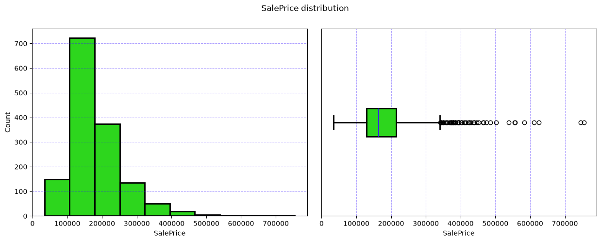

### 2. LotArea
Casi todas las casas tienen un área o superficie total de terreno por debajo de los 20,000. Además, si no consideramos los outliers, hay una ligera relacion entre LotArea y SalePrice, donde a medida que LotArea aumenta, SalePrice tiende relativamente a aumentar un poco.

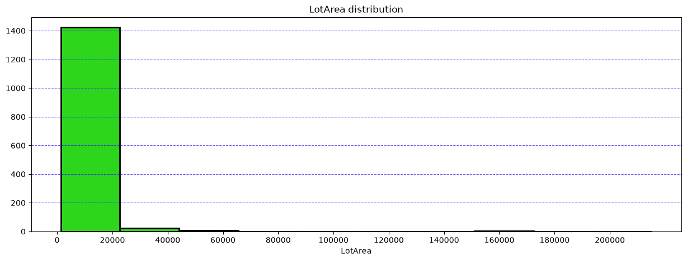

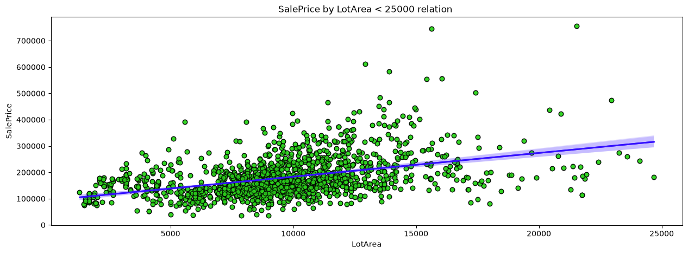

### 3. Neighborhood
Existen vecindarios que tienen una gran diferencia promedio de precio con respecto a otros. Por ejmplo, vivir en "NoRidge" al parecer es donde se tiende a tener precios más altos de vivienda, con un promedio de ≈$330,000. Y el top 3 de lugares más baratos donde vivir son "MeadoWV", "IDOTRR" y "BrkSide" con un promedio de ≈$100,000.

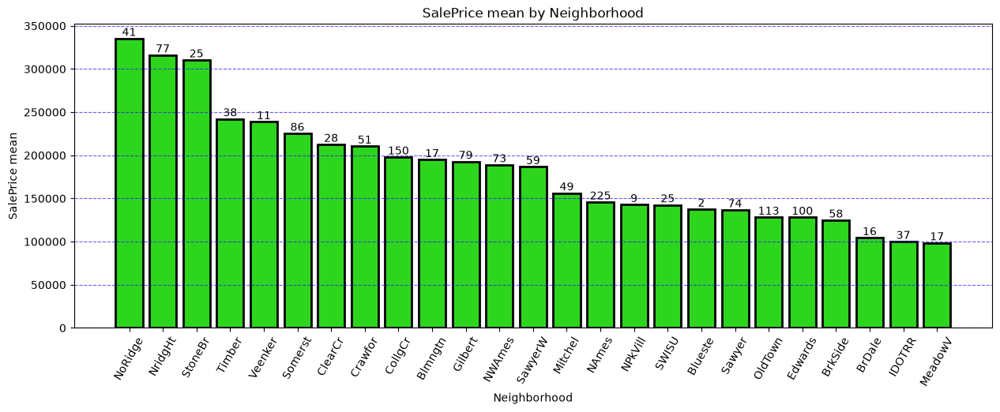

### 4. OverallQual
La calidad general de la casa es probablemente la característica más influyente en el precio de las viviendas, con una relación practicamente lineal, donde cada calidad aumenta la mediana del precio de forma relativamente proporcional. Aunque en las calidades de 8, 9 y 10 el aumento es un poco más notable.

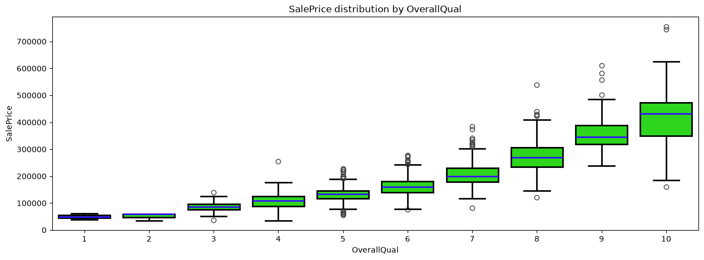

### 5. OverallCond
Las condiciones generales tambíen llevan una relacion lineal en general dentro del aumento de precio, aunque mucho más suavizado. Cabe recalcar una anomalía en donde los hogares con un OverallCond de 5 pueden tener los precios más dispersos y con una mediana incluso más alta que una condición de 10. Además la condición 5 tiene varios más outliers que otras categorías.

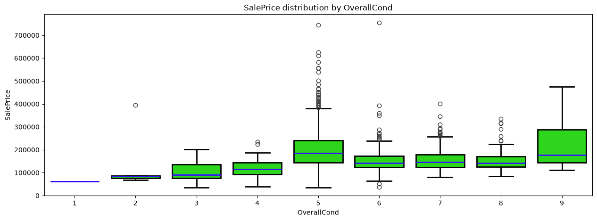

### 6. ExterQual
La calidad del material del exterior usualmente si sube los precios de manera relativamente proporcional, aunque hay un cambio mas fuerte en la mediana con las calidades tipo "Ex"

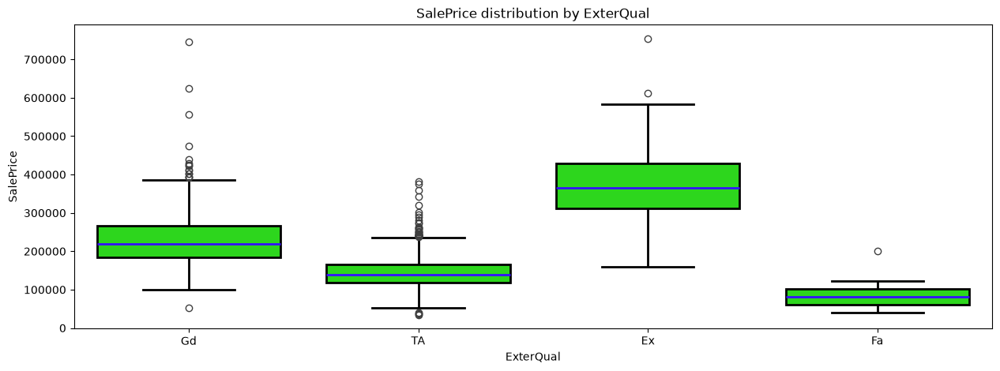

### 7. BsmtQual
La calidad del sótano tiende a aumentar ligeramente en función de calidades mejores, pero la calidad "Ex" aumenta de forma más fuerte el precio de la casa.

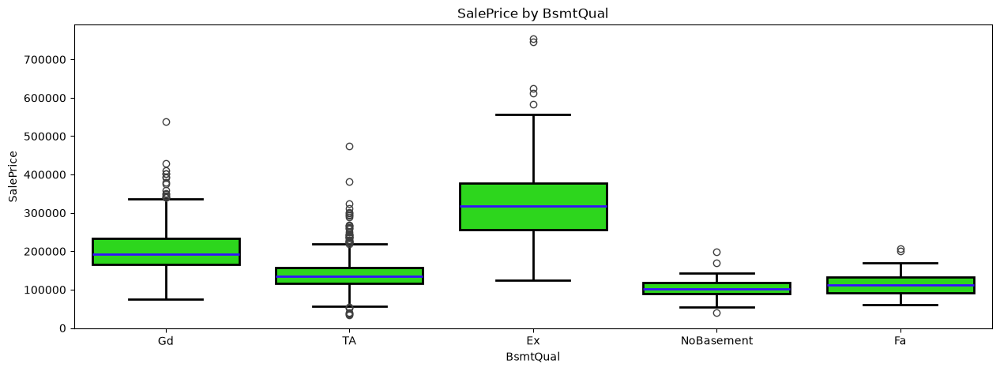

### 8. 1stFlrSF
La mayoría de las casas tiene al rededor de unos 1000 pies cuadrados en la primera planta, además en conforme los pies cuadrados aumentan, los precios tienden a aumentar de forma más significativa. (En el segundo gráfico se ha omitido 1 outlier)

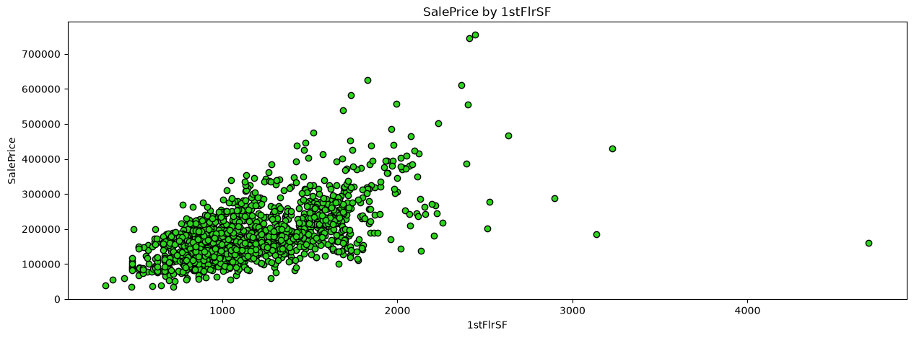

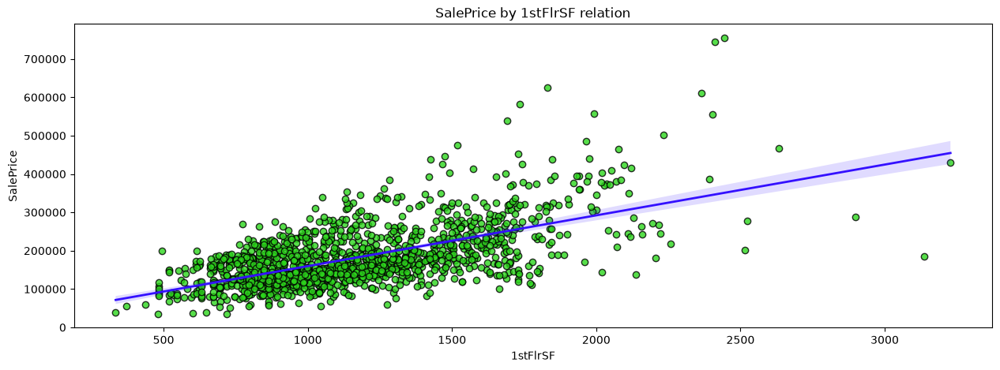

### 9. FullBath
Tener 3 baños por lo visto tiende a aumentar el precio de la vivienda. Cabe señalar que las viviendas con solo 1 baño terminado pueden costar incluso menos que las que no tienen ninguno, esto tal vez se pueda explicar debio a que las casas con 0 baños terminados es probable que sean más nuevas.

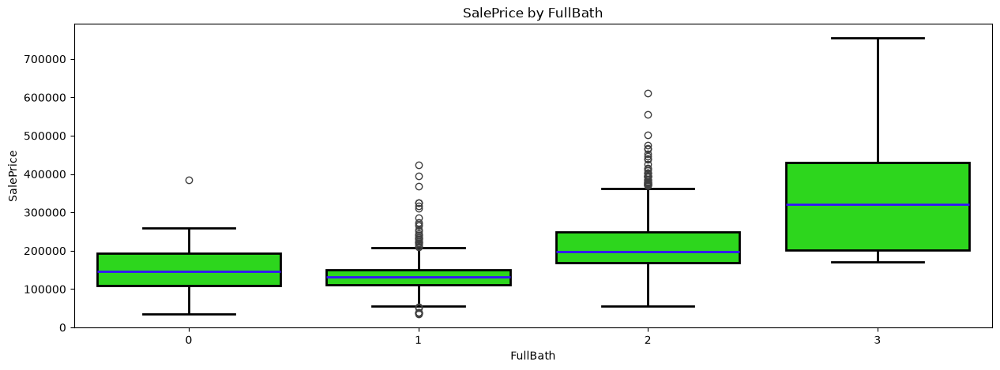

### 10. GrLivArea
La mayoría del area habitable (por encima del nivel del suelo), tiende a estar entre los 900 y 2000 pies cuadrados, además existe una clara relacion positiva entre GrLivArea y SalePrice.

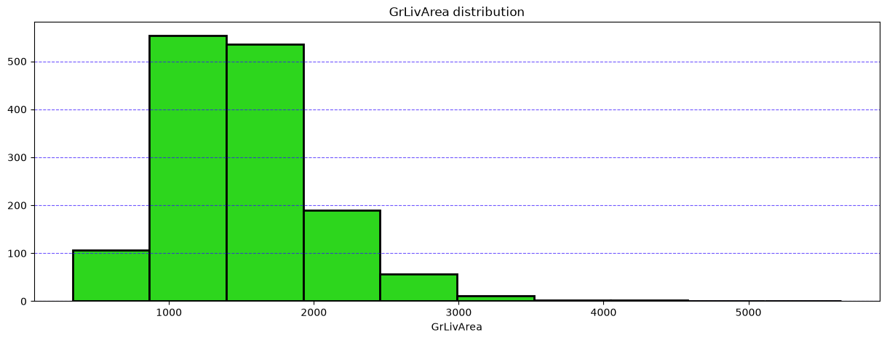

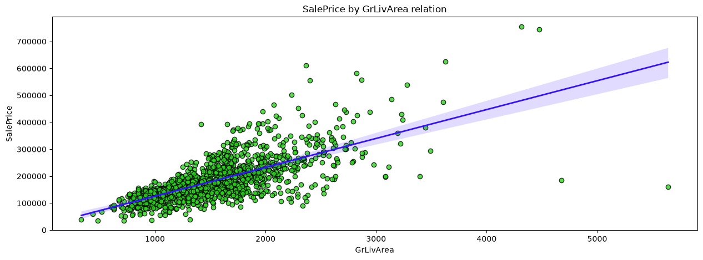

### 11. KitchenQual
La calidad de la cocina también es un buen indicador del precio de la vivienda, aunque en este caso a pesar de que la mediana de la calidad "Ex" es notablemente más alta que el resto, tiene tanto valores bajos y altos de forma normal.

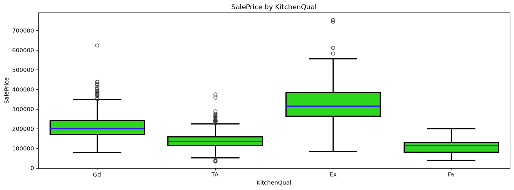

### 12. TotRmsAbvGrd
La mayoría de los hogares tiene entre 5 a 9 habitaciones, considerando salas de estar, comedores, habitaciones, etc. Y el precio promedio aumenta en funcion del aumento de habitaciones, pero con una mayor variabilidad en los precios también.

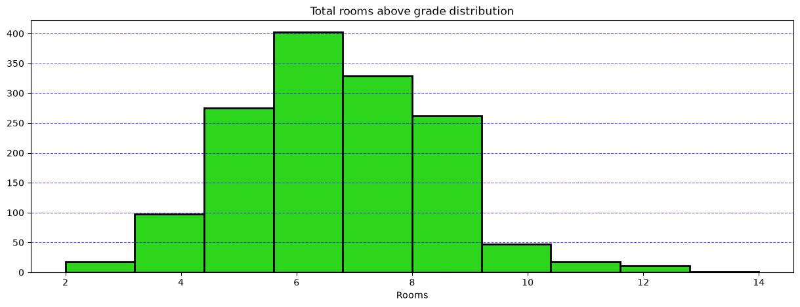

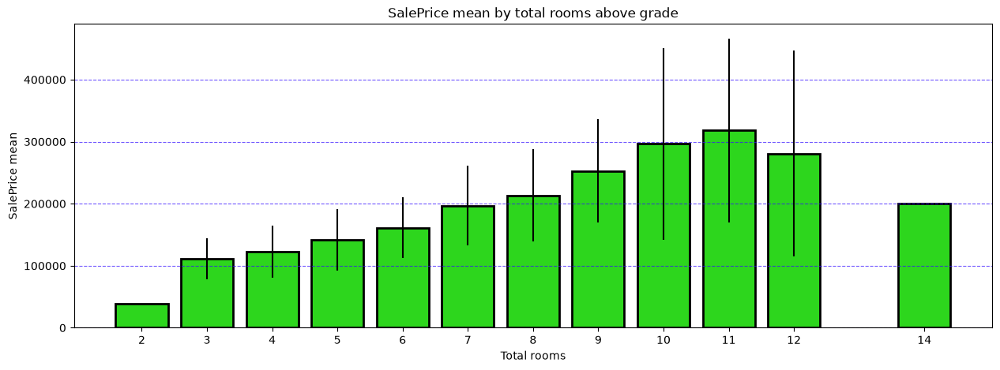

### 13. Garage
En su mayoría, las características referentes al garage como su calidad, su tipo y su condición no influyen de manera muy clara en el precio de la casa. El area (GarageArea) si tiene una relación un poco mas evidente, pero la cantidad de autos que caben en el garage es el mejor indicador en relación al precio. Cabe señalar que curiosamente los garages con la capacidad máxima del dataset (4) tienen valores por debajo de la categoría de 3.

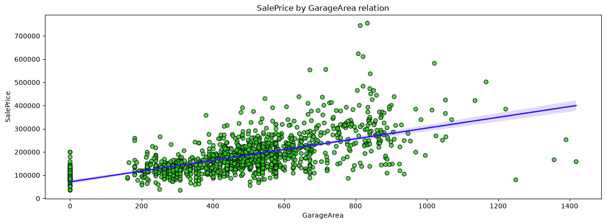

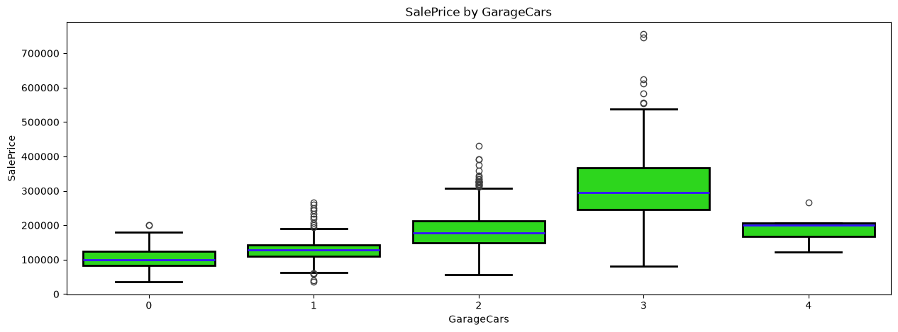

### 14. Correlations

#### 14.1 With SalePrice
Aquí podemos ver la correlación de Pearson con SalePrice, podemos ver como la característica más fuertemente relacionada con el precio, es "OverallQual" seguido de "GrLivArea" y luego "GarageCars", por lo que podemos determinar que en cuanto a variables cuantitativas se refiere, la calidad general de la casa y la capacidad tanto como de espacio para vivir y tener autos es lo que más afecta en el precio.

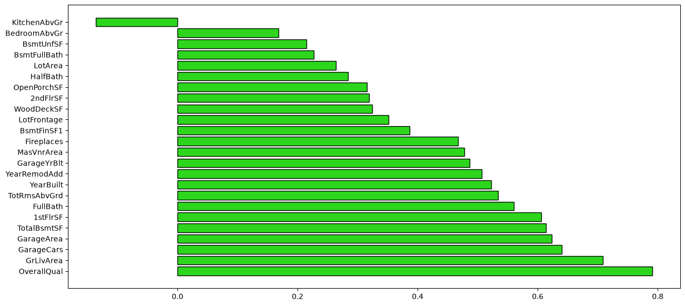

#### 14.2 Between features
En esta visualización se expone a modo general cada relacion de cada feature con el resto. Los puntos en un tono verde más oscuro muestran una mayor correlación, los cercanos al blanco muestran una correlación negativa. Podemos ver correlaciones fuertes esperables como GarageCars/GarageArea o también GrLivArea/TotRmsAbvGrd

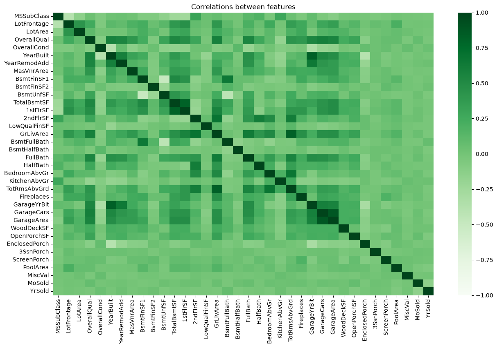

## 🧹 Data cleaning
Para comenzar con el trabajo de la limpieza y transformaciones de los datos, primero se decide identificar los features que sus NaN's no son nulos reales, solo significan que no contienen el feature y también identificar los nulos reales, los cuales se dejarán para el modelado. Estos features son los siguientes:

Features que sus nulos significan auscencia:

- PoolQC
- MiscFeature
- Alley
- Fence
- MasVnrType/MasVnrArea
- FireplaceQu
- GarageType/GarageYrBlt/GarageFinish/GarageQual/GarageCond
- BsmtExposure/BsmtFinType2/BsmtQual/BsmtCond/BsmtFinType1

Features que sus nulos son falta de información:

- LotFrontage
- Electrical

PoolQC: NaN --> "NoPool"

MiscFeature: NaN --> "NoMisceFeat"

Alley: NaN --> "NoAlleyAccess"

Fence: NaN --> "NoFence"

MasVnrType: NaN --> "NoMasVnr"

MasVnrArea: NaN --> 0

FireplaceQu: NaN --> "NoFireplace"

GarageType: NaN --> "NoGarage"

GarageYrBlt: NaN --> 0

GarageFinish: NaN --> "NoGarage"

GarageQual: NaN --> "NoGarage"

GarageCond: NaN --> "NoGarage"

BsmtExposure: NaN --> "NoBasement"

BsmtFinType2: NaN --> "NoBasement"

BsmtQual: NaN --> "NoBasement"

BsmtCond: NaN --> "NoBasement"

BsmtFinType1: NaN --> "NoBasement"

## ⚙️ Preprocessing
Para preprocesar la información se identifica que hay una lista de features que siguen la forma de sus categorías de la siguiente manera:

***"Po" < "Fa" < "TA" < "Gd" < "Ex"***

Los features que tienen esta forma serán reemplazados con un orden de 1 a 5, exceptuando cuando no tenga directamente el feature, que se rellena con un 0.

## 👤 Autor
Carlos Rojas Villegas